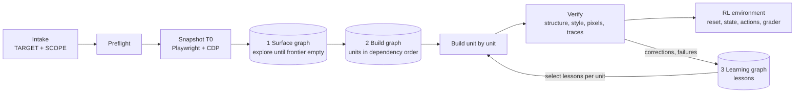
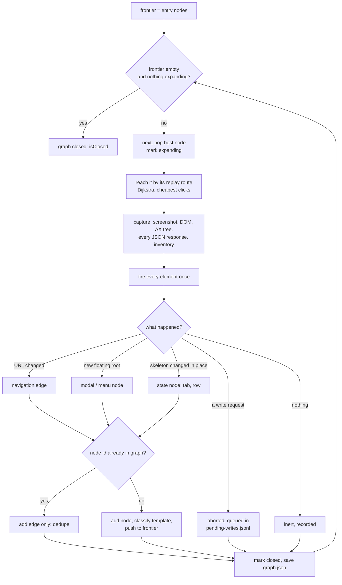
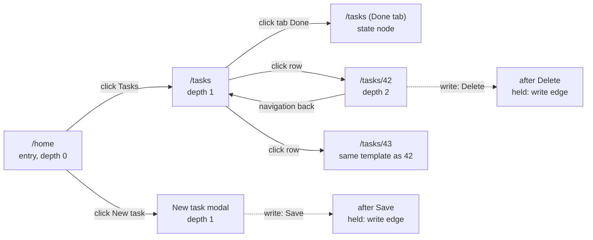
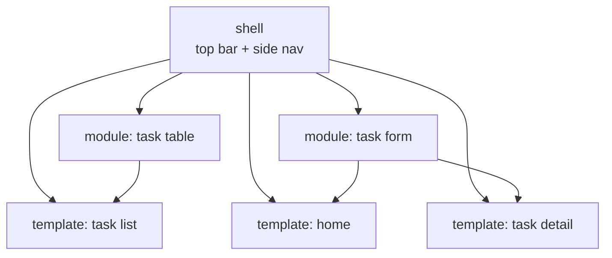
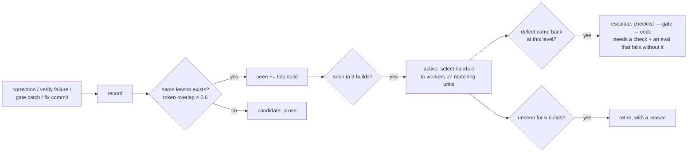
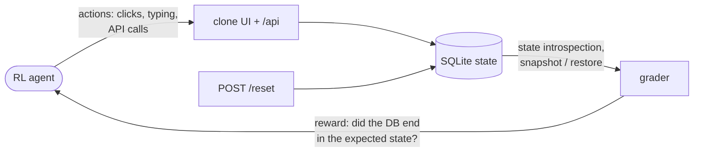

# seemly

Give it a URL. It clones that page, everything on it, and everything reachable from it
into this repo as an RL environment: pixel for pixel, flow for flow, backend, database,
seed and reset included, with zero typed data and zero personal data. It asks one
question at the start, then runs unattended, and it learns from every correction you
give it.

## Setup (once, 2 minutes)

You need [Claude Code](https://claude.com/claude-code) and git.

1. Install the skill (the second line adds `/seemly-video`, which lives in the same repo):
   ```
   git clone https://github.com/PrateekSinghwY/seemly ~/.claude/skills/seemly
   ln -sfn ~/.claude/skills/seemly/video ~/.claude/skills/seemly-video
   ```
2. Restart Claude Code.
3. Open Claude Code in the project you are building and type `/seemly` (live app) or
   `/seemly-video` (recordings only). For video, run once per project:
   `bash ~/.claude/skills/seemly-video/scripts/setup.sh --selftest`. It must print `setup OK`.

If the project has `scripts/research_setup.sh`, run it once; it must print `setup OK`.

## Update

When the owner says seemly was updated:

```
git -C ~/.claude/skills/seemly pull
```

Then restart Claude Code. One pull updates both `/seemly` and `/seemly-video`.

## Or let Claude Code do it

Paste this into Claude Code. It installs the skill if missing, updates it otherwise:

```
Set up the seemly skill for me:
1. If ~/.claude/skills/seemly does not exist, run:
   git clone https://github.com/PrateekSinghwY/seemly ~/.claude/skills/seemly
   Otherwise run: git -C ~/.claude/skills/seemly pull
   Then run: ln -sfn ~/.claude/skills/seemly/video ~/.claude/skills/seemly-video
2. If this project has scripts/research_setup.sh, run it and show me anything that is
   not "ok".
3. Run: bash ~/.claude/skills/seemly-video/scripts/setup.sh --selftest
   and run the exact command on any FIX line, then re-run it until it prints setup OK.
4. Tell me to restart Claude Code so /seemly and /seemly-video load.
```

Do not push to this repo. Send corrections to the owner, who merges them in.

## Consensus thinking: `/seemly use consensus thinking ...`

Runs only when you ask for it. Use it for major calls: a conflict where both PRs change the same
flow, a big flow-related decision, an error with several fixes that change behaviour. Not for
small conflicts or simple errors; seemly resolves those normally. Three agents answer independently, a judge checks their evidence and picks the
best-supported answer, and you get a comparison table, a plan, and a post for the team channel.
Nothing is changed until you say go.

```
/seemly use consensus thinking to solve the conflicts on <PR link>
/seemly use consensus thinking on this error: <paste the error>
```

Full procedure: `reference/panel.md`.

## From videos: `/seemly-video`

When the app cannot be reached (a customer tenant, a paywalled module), recordings are the
reference. Put the videos in the project and type:

```
/seemly-video path/to/videos/
```

It prints one `VIDEO INTAKE` block (videos, source rank, scope, coverage checklist, browser
chrome height, personal values seen). Reply `go`. From there it runs on its own:

1. **Extract**: every decoded frame is analysed at native fps, so a 200 ms tooltip or
   spinner is caught, plus 2 fps samples, scene changes, audio and speech-to-text.
2. **Dedupe in layers**: settle, frame-level, revisit, seen cache, state, cross-video, and
   a pin that never merges away a frame that is the only proof of a checklist item.
3. **Mask**: browser chrome and every name, email, id and host in `pii.json` are blacked
   out before any frame is read. `pii-check` blocks a commit that contains one.
4. **Label** every curated frame (screen, state, flow, fields, which checklist ids it
   proves), **rescue** missing flow steps from the raw frames, and write the **coverage
   gap report**: what the videos prove, and what to record next.
5. **Recon** one spec per screen from the frames, every fact tagged `[frame:<id>]`.
6. **Build** with `/seemly` in video mode, then **verify** every built state against its
   frame with `frame_diff` (text, layout within 4 px or 8 px, accessibility structure).
   The report says `n of N verified`, counted.

Videos, frames, transcripts and `pii.json` stay on your machine: `setup.sh` gitignores them.
Full instructions: [`video/SKILL.md`](video/SKILL.md).

## In one minute

```
seemly https://www.example.com/dashboard
```

1. It looks at the page for two to three minutes and prints one filled-in block
   (scope, depth, reach, login, edition, never-fire list, budget). You reply `go` or
   correct a line. That is the only question it asks.
2. It runs. You hear from it only at `BLOCKED` (do the one thing it names, reply
   `resume`), `SESSION CHECKPOINT` (fresh session, `seemly resume`), or `DONE`.
3. `STATUS` any time. `localhost:3000` shows the clone filling in.
4. Anything else you type mid-run is a correction: saved, applied, learned from.

Attach whatever helps in the same message: screenshots of states it might not reach, a
recording, a sentence about what matters, a login note, a budget. Nothing is required
beyond the URL.

## What it builds

- **Everything reachable by default.** The page, every control and state on it
  (pickers, tabs, dropdowns, modals, carousels, hover states), then every internal link
  under the URL's path prefix, recursively, until no unvisited surface remains. A root
  URL means the whole site. `DEPTH 1` or `DEPTH 0` narrows it.
- **The data layer.** Schema induced from captured payloads with the reference's own id
  formats and ordering; Pydantic, SQLAlchemy and TS mirroring each other; thin routers,
  service layer, linear migrations; `/api` mirroring the reference's requests;
  `POST /reset`, snapshot and restore, state introspection. Seed from capture only,
  byte-identical twice.
- **One shell, one module library, one page component.** Pages sharing a DOM skeleton
  are one template built once; every other page of it is configuration rows. League,
  section or page is a parameter, never a branch.
- **Verified three ways per element**: structure (DOM, role, name, text, href), style
  (every computed CSS property), pixels (per-module diff against an oracle frozen at
  capture time, masks for ads, video and live timestamps). Every click replayed on
  reference and clone and locked as a golden trace.

## How it works

| phase | tool | what happens |
|---|---|---|
| Preflight (10 min) | both | loads the target in Chrome and Playwright, compares edition and login state, checks repo, sets the 2-hour first-page deadline. Refuses to start if the two tools see different sites |
| Snapshot (15 min) | Playwright + CDP | all in-scope pages at one instant T0: hydrated DOM, every XHR body, every window global, images, fonts, computed styles, accessibility tree, full-page pixel oracle |
| Graph | Claude in Chrome | fires every control for real, pushes what opens onto a priority queue, dedupes by URL + DOM skeleton, clusters templates; new nodes captured as T0+n |
| Build | repo | per node: anatomy from capture, semantic skeleton, schema, backend, wire, all eight states, computed-style convergence to zero before "built", mount |
| Verify | both | structure, style, pixels per element; PAGE COMPLETE and MODAL COMPLETE tables; golden traces; a no-context reviewer per batch |
| QA passes | both | with a budget, re-walk everything until the clock runs out |
| Distill | local | turns corrections and lessons into rules, checks and eval cases |

Tool split by strength: Chrome (your real profile) for discovery and behaviour;
Playwright (persistent profile, writes to disk, CDP-only calls) for anything that must
be byte-exact. Both must reach the same edition; preflight enforces it.

## End to end: the three graphs, with a worked example

seemly is three graphs run one after another, each feeding the next:

| # | graph | what a node is | what an edge is | algorithm | code |
|---|---|---|---|---|---|
| 1 | **Surface graph** (explore) | one screen in one state: a page, a modal, an open menu, a selected tab | one interaction: click, hover, keyboard, scroll, redirect, navigation, write | priority queue (indexed heap), dedupe, template clustering, multi-source Dijkstra, BFS depth relaxation, Tarjan | `scripts/orchestrator/graph.mjs` `heap.mjs` `algorithms.mjs` `explore.mjs` |
| 2 | **Build graph** (build) | one build unit: the shell, a module archetype, a page template | "needs": a template needs the shell and its modules | Kahn's topological sort, cycle named by Tarjan | `build.mjs` |
| 3 | **Learning graph** (improve) | one lesson | the ladder: prose → checklist → gate → code | dedupe, promote at 3 builds, escalate on recurrence, retire when stale | `learning/lessons.mjs` |



### The worked example

A tiny target app, `https://tasks.example.com`:

```
/home            dashboard with a "Tasks" link and a "New task" button
/tasks           list of tasks, tabs "Open" | "Done", each row links to /tasks/<id>
/tasks/42        one task, with a "Delete" button
"New task"       a modal with a form and a "Save" button
```

### Graph 1: exploring the surface graph

**A node is a screen in a state.** Its id is `sha1(canonical URL, state, DOM skeleton)`.
The canonical URL drops `utm_*`, `gclid` and the fragment and sorts the query, so
`/tasks?b=2&a=1#top` and `/tasks?a=1&b=2` are the same node. **Dedupe:** reaching a known
node again adds an edge, not a node.

The walk is a loop over a priority queue:



For the example app the walk discovers:



- **Templates.** `/tasks/42` and `/tasks/43` have different text but the same skeleton.
  Similarity is weighted Jaccard over tag-path counts, `sum(min) / sum(max)`. At ≥ 0.92
  (`TEMPLATE_THRESHOLD`) they share one template: **one component, built once**; the second
  task is a configuration row. A list of 500 rows is sampled: five, and more only while new
  templates keep appearing, up to `STATE_BOUND` (30).
- **The shell** is the set of modules on every page (top bar, side nav). It is known only
  once two pages exist, and it only shrinks.
- **Writes are never fired while walking.** `safety.mjs` never fires log out or delete
  account. Save, Delete, Submit and paid actions are held, and every non-read request is
  aborted in the browser. A node reachable only through a write waits for a human `resume`.

**The priority queue.** The frontier is an indexed binary heap (`heap.mjs`). The first key
that differs wins:

| order | key | why |
|---|---|---|
| 1 | reachable without a write first | writes wait for a human |
| 2 | entry nodes first | the first page lands early |
| 3 | template with the most in-edges | the most reused screen is worth finishing first |
| 4 | shallower first | fewer hops to replay |
| 5 | fewer interactive elements | closes fast, unblocks children |
| 6 | node id | stable ties |

Priorities change while nodes wait. A new edge raises a template's in-degree, a shorter
path lowers a depth, and `update(key)` re-sifts just that entry in O(log n). Depth stays
exact by **BFS relaxation**: when a shorter route to a node appears, the new depth is
pushed to everything downstream.

Pop order for the example:

```
pop 1  /home         entry
pop 2  /tasks        depth 1, its template already has 2 in-edges
pop 3  modal         depth 1
pop 4  /tasks/42     depth 2
pop 5  Done tab      state of /tasks
pop 6  /tasks/43     same template: verified as a row, no new component
(held) after Save, after Delete    only through a write
```

**Backtracking without recursion.** A depth-first walker must undo its way back up.
seemly never backtracks: the next pop can be anywhere, and the walker jumps straight to
it by its **replay route**. Routes are a **multi-source Dijkstra** from all entry nodes at
once, with edge costs:

| edge | cost |
|---|---|
| redirect | 0 |
| hover, scroll | 0.5 |
| click, keyboard, navigation | 1 |
| write | ∞, so a replay never fires a write |

`route(/tasks/42)` is `/home → click Tasks → click row 42`, cost 2. The walker opens the
last URL on the route and replays only the clicks after it, so a state encoded in the URL
(`?tab=done`) is the cheapest restore. The same routes become the golden traces.

**Loops are normal.** `/tasks/42 → back → /tasks` is a cycle. Dedupe makes it harmless;
**Tarjan's strongly connected components** (iterative, so deep graphs cannot overflow the
stack) lists such loops for the live diagram.

**Crash-safe.** `graph.json` is the queue itself, written atomically (temp file + rename).
On resume, every `expanding` node goes back on the frontier, so no work is lost or done
twice. `events.jsonl` logs every mutation; `graph.html` and `tree.md` draw the graph live.

### Graph 2: the build graph

When the surface graph is closed, `run.mjs plan` turns it into units:



Kahn's topological sort orders them, breaking ties by how much depends on a unit (the
most-used module first): `shell → task table → task form → home → task list → task
detail`. `next-unit` hands out one unit whose dependencies are built, with a **packet**:
the members, captures, what each control opens, replay routes, writes, and the lessons
selected for it. Two agents never build one template. A dependency cycle throws, with the
loop named by Tarjan.

Each unit is built the same way: anatomy from the capture, semantic HTML, schema from
the captured JSON, backend that mirrors the reference's requests, all eight states,
computed styles converged to zero diff. It is then verified on structure, style, pixels
and the golden trace.

### Graph 3: the learning graph



A worker never reads all the rules. `select` returns at most 20 lessons that match the
unit's phase, kind, area and tool. Gates and code are not returned at all, because they
enforce themselves. The more lessons climb the ladder, the less a worker has to read.

In the example, suppose the first build's modal did not trap focus. The correction
becomes a lesson; next build, `select` hands it to the "New task" modal unit. If the
defect comes back anyway, the lesson escalates into a gate that fails the build.

### How this becomes an RL environment

An RL environment needs a resettable world, an observable state, actions, and a way to
score the result. The clone provides each one:



| RL piece | what seemly builds | example |
|---|---|---|
| **environment** | a pixel- and flow-identical clone, every screen from graph 1 | the task app at `localhost:3000` |
| **reset** | `POST /reset`: seed through the service layer, byte-identical every time | every episode starts with the same 37 tasks |
| **state** | the database, plus snapshot, restore and a generated state contract | `tasks` table, `status` column |
| **actions** | every edge of graph 1 that the clone implements: clicks, hovers, keys, writes | click "New task", type a title, click Save |
| **task** | a golden trace or a write path from graph 1 | "create a task named Q3 report and mark it done" |
| **reward** | the grader checks the end state in the DB and through `/api/openapi.json` endpoints | a row with title "Q3 report" and status `done` exists |

Because the clone mirrors the reference's requests 1:1, a policy learned on the clone
transfers to the real app's UI and API shapes.

### Commands for each stage

```bash
node scripts/orchestrator/run.mjs init --target https://tasks.example.com
node scripts/orchestrator/run.mjs explore --max-nodes 40      # graph 1
node scripts/orchestrator/run.mjs status | tree | frontier | route <id> | loops
node scripts/orchestrator/run.mjs plan                         # graph 2
node scripts/orchestrator/run.mjs next-unit                    # one unit + packet
node scripts/orchestrator/run.mjs unit-done <unit> --verified
node learning/cli.mjs select --phase build --kind modal        # graph 3
node learning/cli.mjs review --builds b1,b2,b3
```

You normally never type these: `/seemly` runs them. They are here so you can see where
a run is (`status`, `tree`) and why a node is next (`frontier`, `route`).

## Seeding and schema: the practices it enforces

- **Schema comes from captured payloads, never from memory.** Every XHR body, every
  hydrated DOM section and every page global is a payload. Per endpoint it induces the
  request and response shape, status codes and error bodies, id format (numeric string,
  uuid, prefixed), ordering strategy (integer position, array order, fractional index),
  timestamp format and timezone, pagination shape. All matched exactly; a wrong id
  format leaks a learnable pattern to the agent being trained.
- **Pydantic, then SQLAlchemy, then TS**, mirroring each other; thin router, service
  layer, one migration per module in a linear chain with a working `downgrade()`;
  indexes on every FK and every filtered or sorted column.
- **Seed only from the capture** while the reference is reachable. No synthesis, no
  fixtures on a production path, no canned fallback. 12 items rendered means those 12
  seeded. Row-count parity is checked per module: reference = seed = endpoint.
- **Determinism**: seeded RNG, frozen clock at T0, stable ids in the reference's format,
  seeded through the service layer, reset and seed twice byte-identical, `POST /reset`
  idempotent, snapshot restores byte-identically, state contract regenerated and never
  hand-edited. Baseline seed and scenario seeds kept separate.
- **Always-present tables**: `page`, `page_module`, `nav_item`, `ui_copy`, `asset`, plus
  whatever the payloads force. Every column a surface reads is written by something.
- **Scrub before store**: identity keys and values (emails inside payload bodies
  included), then a personal-detail grep after every page. A hit stops the capture.

## Tools: which one, for what, and why that is the efficient choice

| tool | used for | why it is efficient there |
|---|---|---|
| **Claude in Chrome** (extension, your real profile) | discovery: hover every nav item, open every dropdown, picker, tab, modal, carousel; read what opened; confirm a redirect or edition; replay a click on the clone; redact-then-shoot screenshots when signed in | no capture run burned per question; sees the hydrated UI as a user does; already has your session and VPN; reading the DOM or running JS is one call |
| **Playwright** (persistent profile) | the T0 snapshot of all pages, every capture to disk, the pixel oracle, the pixel diff, step 8 style convergence, the app-renders gate | the only tool that writes files; Chrome MCP truncates near 1 KB per string and 100 items per array, so a 1 MB DOM through it is about 1,000 round trips against one write |
| **CDP** (through Playwright) | `DOMSnapshot` with the full computed-style manifest, `getFullAXTree`, `forcePseudoState` for hover and focus, `getPlatformFontsForNode`, `getResponseBody`, `Debugger.getScriptSource`, coverage, `Input.dispatchMouseEvent` at box-model centres, full-page screenshots under the determinism lock | none of these exist in Chrome MCP; they turn "renders" into "matches": about 120 CSS properties per element diffed as expected vs got, same Chrome build on both sides |

How it keeps the tools efficient, not merely used:

- **Preflight refuses to start** unless both tools reach the same edition and login state.
- **One snapshot instant** for all pages (about 15 minutes) instead of page by page over hours.
- **Discovery and build overlap**: Chrome expands the graph while Playwright captures new
  nodes and the shell builds from the snapshot.
- **Templates, not pages**: nodes with the same DOM skeleton are captured for style once
  and built once; 300 game pages cost one template plus configuration rows.
- **Clips cropped from the full-page oracle**, never re-shot per module.
- **Every crossing logged**: a Playwright use during discovery or a Chrome use during
  capture needs a row in `tool-fallbacks.md` with the reason.
- **Gates start their own instances** on free ports; nothing trusts a stale server.
- **Convergence rounds predicted vs actual** per node; a rising trend halts the node and
  writes a lesson, so a misused tool shows up as a number.

Details: `reference/tool-split.md` (with the eight known Chrome MCP limitations and the
workaround for each), `reference/backend.md`, `reference/capture-rules.md`.

## The words

| word | effect |
|---|---|
| `go` | confirm the intake block, start |
| `resume` / `seemly resume` | continue after BLOCKED, or in a fresh session after a checkpoint |
| `done` | you finished a manual step (login, VPN) in the window it opened |
| `STATUS` | six-line position report, keeps running |
| `STOP` | the only halt; finishes the atomic step, writes RESUME.md |
| `distill` | run the learning step now (also automatic at checkpoints and DONE) |
| `promote` | move chosen local learnings into the team skill as a branch for PR |

Everything else is a correction. Case matters only for `STATUS` and `STOP`.

## What stays local, what is shared

| what | where | pushed? |
|---|---|---|
| the skill (team base) | `~/.claude/skills/seemly/` (this repo) | by the owner, after `promote` |
| corrections, lessons, overlay rules, scorecard history | `never_to_be_pushed/seemly-local/` | never |
| discovery, captures, resume state | `never_to_be_pushed/discovery/` | never |
| the clone | `frontend/ backend/ scripts/ e2e/ docs/` | yes, on `feat/*` |

Overlay rules win over the base. `promote` is how a rule you taught it becomes a team
default; corrections themselves are never shared.

## Files in this folder

| file | read it when |
|---|---|
| `SKILL.md` | the procedure; Claude Code loads it |
| `INTAKE.md` | you want to know what to type or attach |
| `TEAM.md` | onboarding a teammate |
| `distill.md` | how learning works |
| `reference/decisions.md` | every default; the answer to "why did it do X" |
| `reference/graph.md` | how exploration order and reuse are decided |
| `reference/tool-split.md` | why Chrome here and Playwright there |
| `reference/capture-rules.md` | what the snapshot must contain and the filters it must never use |
| `reference/checks.md` | the 21 gates that run on every commit |
| `reference/backend.md` | the data-layer contract |
| `reference/principles.md` | every lesson so far, stated for any site |
| `reference/defects.md` | the defect catalogue |
| `reference/method/` | the base method (RL_BUILD, RECON, BUILD_PROTOCOL, SELF_CORRECTION) |
| `scripts/` | working gates and capture tools from the first build |
| `templates/` | RESUME and SCORECARD shapes |
| `corrections/2026-09-22-espn/` | the founding build: 27 corrections and what each became |
| `evals/cases.md` | 24 failure cases a change must not regress |

## Requirements

Claude Code with the Claude in Chrome extension connected; Node 20+; Python 3.11+;
Playwright (installed at first preflight if missing); a VPN both tools can use if the
target geo-routes. The repo's `AGENTS.md` wins on stack and conventions.

## Accuracy

Measured, never claimed: `templates/SCORECARD.md` is filled at every DONE with
provenance, pixel parity per module, structure and style pass rates, human
interventions, time to first page, convergence-rounds trend. The previous build's column
is the bar the next one must beat. Founding baseline (ESPN, Sept 2026): 8,204 / 8,204
text nodes traced, ~15 interventions, ~6h to first page. Targets: 100%, under 3, under 2h.
